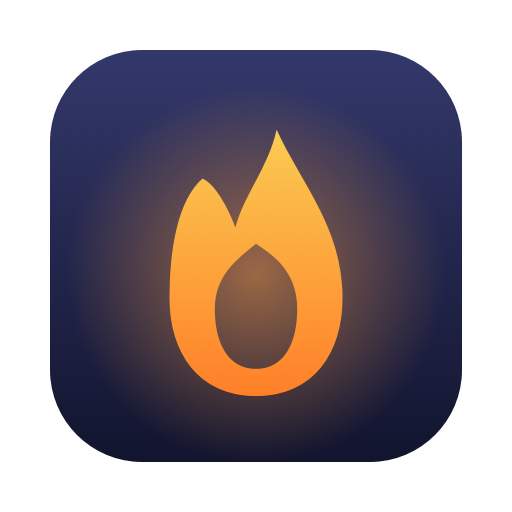

<p align="center">
  
</p>

<h1 align="center">Midnight Oil</h1>

<p align="center">Keep your Mac awake so your AI agents, builds, and downloads can finish.<br>Free, source available, and actively maintained. A modern replacement for Amphetamine.</p>

<p align="center">
  <a href="https://github.com/coreyhaines31/midnightoil/releases/latest"><b>Download</b></a> ·
  <a href="https://midnightoil.app">Website</a> ·
  <a href="https://midnightoil.app/guides">Guides</a> ·
  <a href="https://github.com/coreyhaines31/midnightoil/issues">Report a bug</a>
</p>

---

Midnight Oil lives in your menu bar as a small flame. Click it, pick how long, and your Mac stays awake: overnight while Claude Code, Codex, or Cursor works through a task, until a download finishes, or with the lid closed in your bag. When the session ends, your Mac goes back to its normal sleep settings on its own.

- [Install](#install)
- [Your first session](#your-first-session)
- [Permissions it may ask for](#permissions-it-may-ask-for)
- [Features](#features)
- [Troubleshooting](#troubleshooting)
- [Updating and uninstalling](#updating-and-uninstalling)
- [Privacy](#privacy)
- [Building from source](#building-from-source)
- [License](#license)

## Install

Requires macOS 14 Sonoma or later, on Apple silicon or Intel.

**Homebrew**

```sh
brew install --cask coreyhaines31/tap/midnightoil
```

**Or download it**

1. Download `MidnightOil-x.y.z.dmg` from the [latest release](https://github.com/coreyhaines31/midnightoil/releases/latest).
2. Open the DMG and drag **Midnight Oil** to **Applications**.
3. Open Midnight Oil from Applications.

The app is signed and notarized by Apple, so it opens without warnings, and it updates itself.

## Your first session

Midnight Oil has no Dock icon and no window. After you open it, look for the **flame in the menu bar**, near the clock.

> **Don't see it?** On a MacBook with a notch, a crowded menu bar can hide icons behind the notch. Quit an app you don't need in the menu bar, or hold <kbd>⌘</kbd> and drag other icons to make room.

1. **Click the flame.**
2. **Pick how long:** *Keep Awake Indefinitely*, *Keep Awake For* (5 minutes to 12 hours), *Keep Awake Until* a time, *While App Is Running*, or *While File Is Downloading*.
3. **Walk away.** The flame lights up while a session runs. Click it to see the time left, extend the session, or end it.

Two options on the running session card are worth knowing:

- **Allow display sleep** lets the screen turn off while the Mac keeps working. This is what you want for overnight runs.
- **Stay awake with lid closed** keeps a MacBook running after you close it. It needs a one-time setup, described next.

To start Midnight Oil when you log in, turn on *Launch at login* in **Settings › General**.

## Permissions it may ask for

Midnight Oil asks for nothing up front. macOS asks for each permission only the first time you use the feature that needs it:

| Feature | What macOS asks | Where to change it later |
|---|---|---|
| Closed-lid mode | Approve the Midnight Oil helper | System Settings › General › Login Items (& Extensions) |
| Wi-Fi network triggers | Location access, because macOS treats the network name as location data | System Settings › Privacy & Security › Location Services |
| Bluetooth device triggers | Bluetooth access | System Settings › Privacy & Security › Bluetooth |
| Notifications | Permission to show notifications | System Settings › Notifications |

**Setting up closed-lid mode:** open **Settings › Closed Lid** and click **Install…**, and macOS opens Login Items. Switch on **Midnight Oil** under *Allow in the Background*. That's the only time you'll need an admin password. You can remove the helper from the same settings pane.

## Features

- **Sessions**: keep awake indefinitely, for a set time, until a clock time, while an app is running, or while a file downloads. Extend a running session without restarting it.
- **Closed-lid mode**: keep a MacBook running with the lid shut. Normal sleep comes back when the session ends, when the app quits, and even if the app crashes ([how it works](#how-closed-lid-mode-works)).
- **Schedules**: stay awake at the same times every week, like weekdays 9 to 5 or every night while your agents run. Add conditions such as “only while plugged in,” and skip a window from the menu when you take a day off.
- **Triggers**: start a session automatically while conditions hold: a Wi-Fi network, a USB or Bluetooth device, an external display, power source, battery level, an app running or in front, an IP address, a schedule, or how long you've been idle.
- **Battery safety**: end sessions when you unplug or when the battery drops below a level you choose, and hear an alarm if the lid closes on battery.
- **Drive Alive**: keep the external drives you pick from spinning down.
- **Hot keys**, **custom menu bar icons**, **notifications**, and **statistics**, including a CSV export of every session.
- **Moves like every other menu bar icon**: hold <kbd>⌘</kbd> and drag the flame wherever you want it.

Every setting has an ⓘ: hover for a hint, click for the full explanation.

## Troubleshooting

**My Mac still went to sleep.**
- If you closed the lid, check that the session has *Stay awake with lid closed* turned on and that the helper is installed and approved (**Settings › Closed Lid**).
- If a session was set to end on unplug or low battery, it ended on purpose. The menu shows why the last session ended.
- Run `pmset -g assertions` in Terminal while a session is running. You should see Midnight Oil listed as preventing sleep.

**A Wi-Fi trigger never starts.** macOS only reveals the network name to apps with Location access. If you declined the prompt, the Wi-Fi condition shows a notice with a **Turn On…** button, or go to System Settings › Privacy & Security › Location Services.

**The external drive still sleeps.** Add it in **Settings › Drive Alive**, or turn off *Put hard disks to sleep when possible* in System Settings › Battery › Options (or Energy on a desktop Mac).

**Something else.** [Open an issue](https://github.com/coreyhaines31/midnightoil/issues/new/choose) with your macOS version, your Mac model, and what you expected to happen. The [guides](https://midnightoil.app/guides) cover macOS sleep settings, clamshell mode, and running AI agents overnight.

## Updating and uninstalling

**Updating:** Midnight Oil checks for updates on its own, and you can check any time from the menu with **Check for Updates…**. With Homebrew, `brew upgrade --cask midnightoil` works too.

**Uninstalling:**

1. If you installed the closed-lid helper, open **Settings › Closed Lid** and click **Remove**.
2. Quit Midnight Oil from its menu.
3. Delete it from Applications, or run `brew uninstall --cask midnightoil`.

To remove its settings and session history as well, delete `~/Library/Application Support/Midnight Oil` and `~/Library/Preferences/app.midnightoil.MidnightOil.plist`, or run `brew uninstall --zap --cask midnightoil`.

## Privacy

Midnight Oil has no account and no analytics. Its only network request is the update check to GitHub, which you can turn off with *Check for updates automatically* in **Settings › General**. Session history stays on your Mac.

## Building from source

### Requirements

- Xcode 16 or later
- [XcodeGen](https://github.com/yonaskolb/XcodeGen) and [SwiftLint](https://github.com/realm/SwiftLint)

```sh
brew install xcodegen swiftlint
```

### Build and test

The Xcode project is generated from `project.yml`, so it isn't checked in. Generate it first:

```sh
xcodegen generate
```

Run the tests and the linter the same way CI does. This needs no signing certificate:

```sh
xcodebuild -project MidnightOil.xcodeproj -scheme MidnightOil CODE_SIGNING_ALLOWED=NO test
swiftlint --strict
```

### Run your own build

To run the app, open `MidnightOil.xcodeproj` in Xcode, choose your own team under *Signing & Capabilities* for the **MidnightOil** and **MidnightOilHelper** targets, and press Run.

**Closed-lid mode in your own build:** the helper only accepts connections from an app signed by the official team, so closed-lid mode won't work in a build signed by anyone else. To try it, replace the team ID `KPQU8X839X` with yours in `Shared/HelperProtocol.swift` and `project.yml`. Don't commit that change. Everything else works without it.

### Project layout

| Path | What's in it |
|---|---|
| `MidnightOil/` | The menu bar app (SwiftUI and AppKit) |
| `Packages/MidnightOilCore/` | Session timing, trigger rules, schedules, download detection, and statistics, with unit tests; no app needed to test them |
| `MidnightOilHelper/` | The privileged helper for closed-lid mode |
| `Shared/` | The protocol between the app and the helper |
| `ee/` | Midnight Oil for Teams, under a separate commercial license |
| `site/` | The website, generated by `site/_build/render.py` |
| `Scripts/release.sh` | Builds, notarizes, and publishes a release |

Contributions are welcome. See [CONTRIBUTING.md](CONTRIBUTING.md).

### How closed-lid mode works

macOS sleeps a laptop when the lid closes, whatever apps ask for. Midnight Oil ships a small helper, registered with `SMAppService`, that runs `pmset disablesleep 1` as root while a closed-lid session runs and `pmset disablesleep 0` the moment it ends. If the app quits or crashes, the helper notices the dropped connection and restores sleep. If the helper itself stops, launchd restarts it and it restores sleep on launch. Nothing is left disabled behind your back.

### Releasing

Maintainers release from `main` with `Scripts/release.sh 1.2.3`. It builds, signs with a cloud-managed Developer ID, notarizes the app and the DMG, signs the Sparkle update, publishes the GitHub release, and updates the Homebrew cask. The script's header lists the one-time credentials it needs.

## Midnight Oil for Teams

Organizations that manage Macs can deploy Midnight Oil with their MDM, lock policies, get session webhooks, and see their fleet on a dashboard. That code lives in `ee/` under its own [commercial license](ee/LICENSE). None of it changes how the app behaves, or contacts any server, unless an organization's license and configuration profile turn it on. Details at [midnightoil.app/teams](https://midnightoil.app/teams).

## License

[FSL-1.1-MIT](LICENSE) © Corey Haines. Free to use and modify, including at work. You can't resell it or build a competing product from it. Each release becomes MIT two years after it ships, and versions 1.0.0 through 1.3.0 are MIT already.

The Midnight Oil name and icon are covered by the [trademark policy](TRADEMARK.md). Contributions are welcome under the [contributor terms](CONTRIBUTING.md).
